<div align="center">
  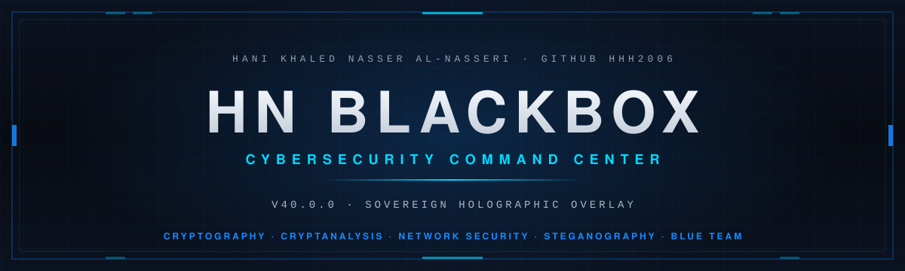

  <p>
    <b>Local-first cybersecurity learning and engineering command center</b><br />
    <sub>Cryptography · Cryptanalysis · Network Security · Web Labs · Blue Team · Security Labs</sub>
  </p>

  <p>
    
    
    
    
    
    
  </p>

  <p>
    <a href="#highlights"><b>Highlights</b></a> ·
    <a href="#screenshots"><b>Screenshots</b></a> ·
    <a href="#cryptography"><b>Cryptography</b></a> ·
    <a href="#architecture"><b>Architecture</b></a> ·
    <a href="#run-it"><b>Run it</b></a> ·
    <a href="#installation"><b>Installation</b></a> ·
    <a href="#testing"><b>Testing</b></a> ·
    <a href="#visual-renderer"><b>Renderer</b></a> ·
    <a href="#project-history"><b>History</b></a> ·
    <a href="#author"><b>Author</b></a> ·
    <a href="#license"><b>License</b></a>
  </p>
</div>

<p align="center">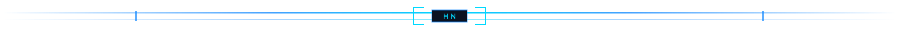</p>

# HN BlackBox CyberSecurity

**HN BlackBox** is my cybersecurity learning and engineering project. I built it to turn the topics I study into practical software that I can test, improve, and keep using as I learn more.

The project brings several areas together in one desktop workspace: cryptography, cryptanalysis, network security, web-security labs, blue-team exercises, security tools, local intelligence, and hands-on labs.

> **Educational / defensive use:** only test systems, applications, networks, and data that you own or are explicitly authorized to test.

## Highlights

- **Cryptography:** classical ciphers, extended algorithms, AES utilities, and algorithm-focused visual explanations.
- **Cryptanalysis:** frequency analysis, coincidence analysis, Kasiski-style analysis, and related tools.
- **Modern Security:** DES, AES-256, RSA, hashing, and step-by-step teaching views.
- **Steganography:** image-based LSB hiding/extraction with pixel and payload analysis.
- **Network Security:** local network inspection, diagnostics, graphs, and defensive utilities.
- **Web Security:** controlled educational web-security labs.
- **Blue Team:** defensive analysis, rules, and investigation workflows.
- **Security Labs:** deterministic offline labs with progress, hints, attempts, and scoring.
- **File Intelligence:** hashes, metadata, entropy, strings, and related local analysis.
- **Desktop GUI:** a dark HN command-center interface with animated visual effects and live local status views.
- **CLI / Console:** local command-line workflows for Windows and Linux/Kali.

<p align="center"></p>

## Screenshots

Current V40 interface captures from the release audit. Full-size files live in [`docs/screenshots/`](docs/screenshots/), with additional previews in [`assets/previews/`](assets/previews/).

<table>
  <tr>
    <td width="50%">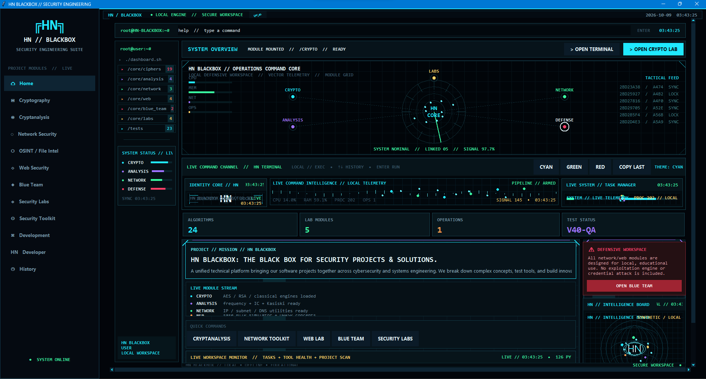<br /><sub><b>Dashboard</b> — main command center</sub></td>
    <td width="50%">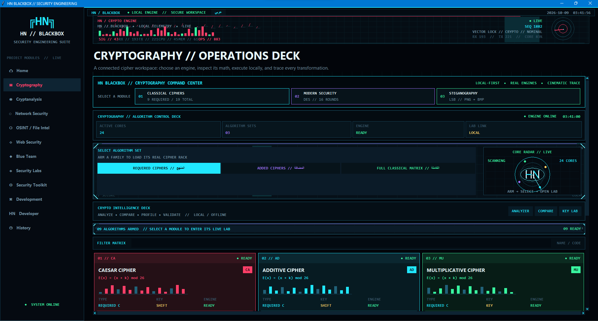<br /><sub><b>Cryptography</b> — classical and modern workspaces</sub></td>
  </tr>
  <tr>
    <td width="50%">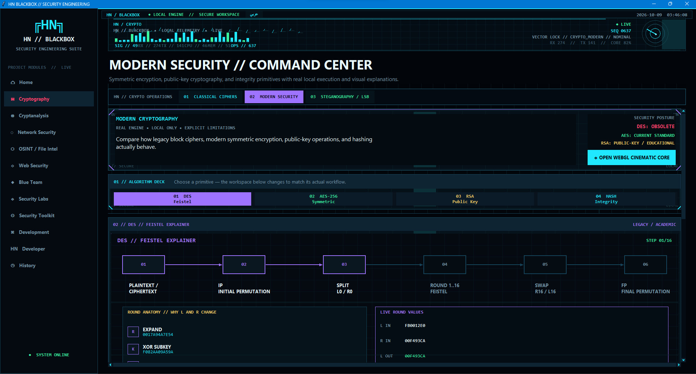<br /><sub><b>Modern security</b> — DES / AES workspace</sub></td>
    <td width="50%">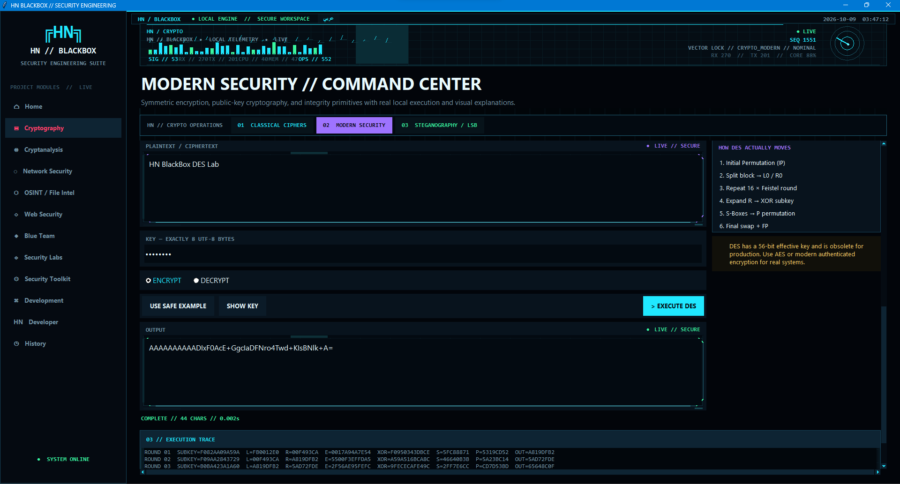<br /><sub><b>Modern security</b> — algorithm detail view</sub></td>
  </tr>
  <tr>
    <td width="50%">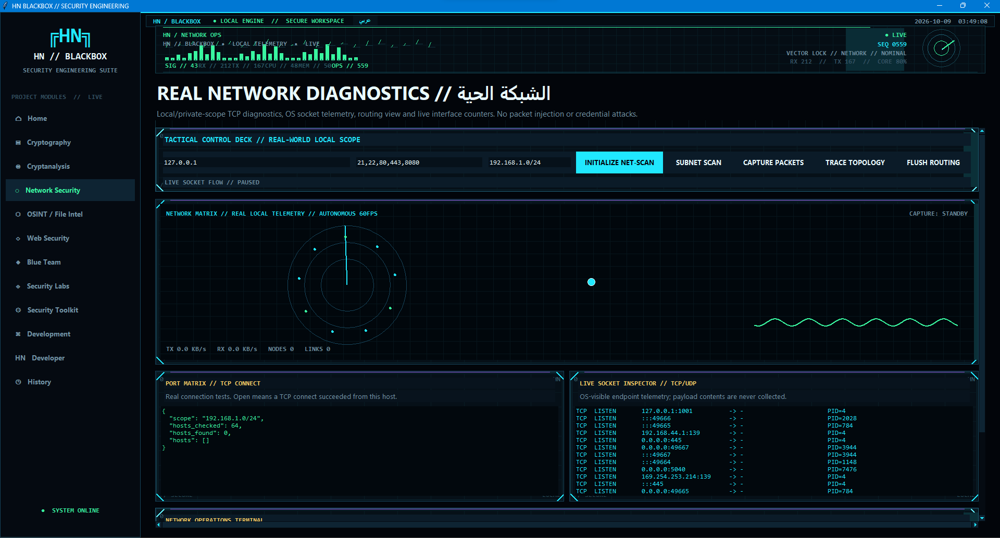<br /><sub><b>Network security</b> — diagnostics and graphs</sub></td>
    <td width="50%">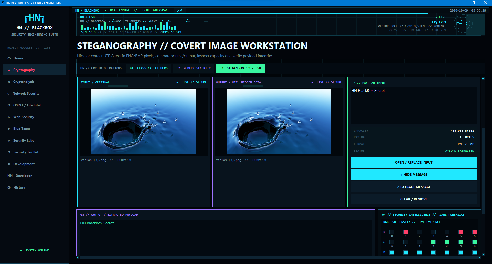<br /><sub><b>Steganography</b> — LSB payload and pixel analysis</sub></td>
  </tr>
  <tr>
    <td width="50%">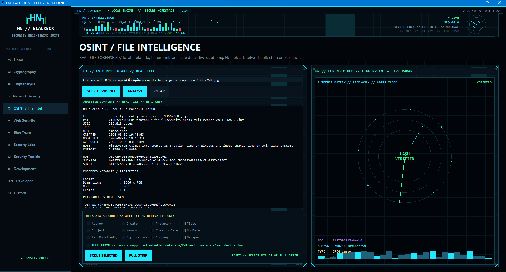<br /><sub><b>OSINT</b> — local intelligence workspace</sub></td>
    <td width="50%">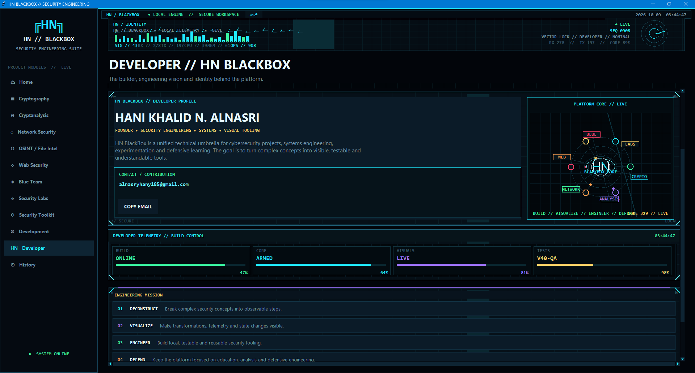<br /><sub><b>Developer</b> — platform section</sub></td>
  </tr>
</table>

<p align="center"><sub>Captures are documentation assets, not a live demo. Telemetry shown in the interface is synthetic presentation data unless explicitly identified as a real local measurement.</sub></p>

## Cryptography

The core requested classical algorithms are kept together under `core/cryptography/required_algorithms/`:

```text
caesar.py
additive.py
multiplicative.py
affine.py
vigenere.py
autokey.py
rail_fence.py
```

The application also exposes additional classical and modern algorithms through the extended/full views.

## Project layout

```text
core/                  Core security and cryptography logic
gui/                   Desktop application
renderer/              WebGL2 cinematic renderer
tests/                 Automated tests
docs/                  Current documentation and project history
docs/site/             GitHub Pages visual site
assets/                Application assets
plugins/               Plugin area
main.py                GUI entry point
blackbox_cli.py        CLI entry point
blackbox_console.py    Interactive console
```

More details are in [`docs/architecture.md`](docs/architecture.md).

## Architecture

The workspace is split by responsibility instead of keeping every Python module directly under `core/`. The diagram mirrors the module breakdown documented in [`docs/architecture.md`](docs/architecture.md):

<p align="center">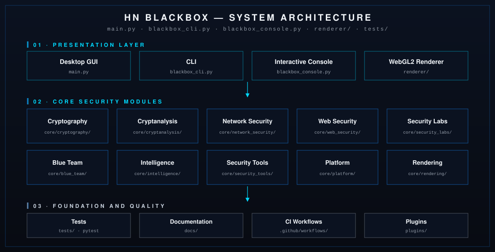</p>

<p align="center"><sub><b>01 Presentation</b> — <code>main.py</code>, <code>blackbox_cli.py</code>, <code>blackbox_console.py</code>, <code>renderer/</code> &nbsp;·&nbsp; <b>02 Core</b> — ten <code>core/</code> security modules &nbsp;·&nbsp; <b>03 Foundation</b> — <code>tests/</code>, <code>docs/</code>, CI, <code>plugins/</code></sub></p>

## Run it

### Windows

The easiest option is:

```text
run_windows.bat
```

For the desktop application directly:

```bash
python main.py
```

### CLI

```bash
python blackbox_cli.py --help
```

### Interactive console

```bash
python blackbox_console.py
```

### Linux / Kali

```bash
./run_blackbox_cli.sh
```

## Installation

Python 3.11 or newer is recommended.

```bash
python -m venv .venv
```

Windows:

```powershell
.venv\Scripts\activate
```

Linux/macOS:

```bash
source .venv/bin/activate
```

Then install the Python dependencies:

```bash
pip install -r requirements.txt
```

The optional WebGL renderer has its own Node/Vite dependencies in `renderer/`.

## Testing

Run the test suite with:

```bash
pytest -q
```

The project is tested locally and in CI. GUI tests on Linux can run under Xvfb.

## Visual renderer

The cinematic layer uses WebGL2 with Three.js, GSAP, PixiJS, and tsParticles. It is a presentation layer; cryptographic operations remain in the Python application and are not replaced by browser-side mock implementations.

The GitHub Pages site contains a visual demonstration. Telemetry shown there is synthetic presentation data unless explicitly identified as a real local measurement.

## Project history

HN BlackBox has gone through several internal iterations. The current public release is **V40.0.0 — SOVEREIGN HOLOGRAPHIC OVERLAY**.

Older development notes are kept in [`docs/history/`](docs/history/) where they are useful for understanding how the project evolved. The current documentation describes V40 rather than those earlier iterations.

See [`CHANGELOG.md`](CHANGELOG.md) for the consolidated release history.

<p align="center"></p>

## Author

**Hani Khaled Nasser Al-Nasseri**  
Cybersecurity Student & Developer

This is a personal long-term project that I develop while studying cybersecurity and building practical experience.

- Email: `alnasryhany185@gmail.com`
- GitHub: `hhh2006`

## Contributing

Bug reports, improvements, and pull requests are welcome. See [`CONTRIBUTING.md`](CONTRIBUTING.md).

## Security

For security issues, please read [`SECURITY.md`](SECURITY.md) before opening a public issue.

## License

MIT License. See [`LICENSE`](LICENSE).

<p align="center"></p>

## Also from HN

<table>
  <tr>
    <td width="150" align="center">
      
    </td>
    <td>
      <h3>HN NEXUS</h3>
      <p>Cinematic, context-aware and recovery-aware ZSH command environment for Kali Linux: three-row HUD prompt, 15 Prism visual profiles, operator utilities, advisory helpers, and backup/rollback-aware installation.</p>
      <p>
        
        
        
      </p>
      <p><a href="https://github.com/hhh2006/HN-NEXUS"><b>Explore the repository →</b></a></p>
    </td>
  </tr>
</table>

### Technology indicators

<p>
  
  
  
  
</p>

### Connect

<p>
  <a href="https://github.com/hhh2006"></a>
  <a href="https://www.instagram.com/haninazarene/"></a>
  <a href="https://www.threads.net/@haninazarene"></a>
  <a href="https://www.facebook.com/profile.php?id=100093188341353"></a>
</p>

<div align="center">
  
  <p><sub>Engineered by HN · <a href="https://github.com/hhh2006">hhh2006</a> · <a href="mailto:alnasryhany185@gmail.com">alnasryhany185@gmail.com</a> · <a href="https://github.com/hhh2006/HN-NEXUS">HN NEXUS</a></sub></p>
</div>
